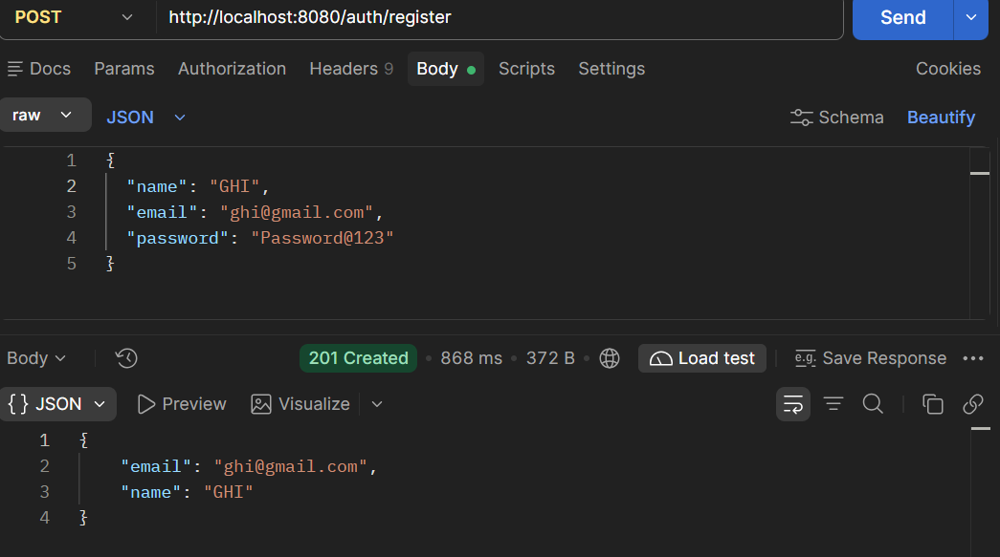

# Job Matcher

A full-stack job matching platform built with **Java, Spring Boot, PostgreSQL, Redis, and React**.

Job Matcher connects users with relevant job opportunities based on their skills and experience level. The application provides secure authentication, job and skill management, dynamic filtering, skill-based matching, Redis caching, automated testing, Swagger API documentation, Docker support, and a responsive React frontend.

---

## Overview

Job Matcher allows users to:

- Register and authenticate using JWT
- Sign in using Google OAuth2
- Manage their profile and skills
- Browse available jobs
- View jobs using multiple filters
- Associate skills with users and jobs
- Get personalized job matches based on their skills
- View matched and missing skills for each job
- Retrieve frequently requested matching results using Redis caching

Administrators can:

- Create jobs
- Update jobs
- Delete jobs
- Manage skills
- View registered users

The backend follows a layered architecture using:

- Controllers
- Services
- Repositories
- DTOs
- JPA Specifications
- Exception Handling
- Security Configuration

---

## Tech Stack

### Backend

- Java 21
- Spring Boot
- Spring MVC
- Spring Data JPA
- Hibernate
- Spring Security
- JWT
- OAuth2 / OpenID Connect
- PostgreSQL
- Redis
- Maven
- Lombok
- ModelMapper
- Jakarta Bean Validation
- Springdoc OpenAPI / Swagger

### Frontend

- React
- Vite
- Tailwind CSS
- Axios
- React Router

### Testing

- JUnit 5
- Mockito
- Spring Boot Test
- MockMvc

### DevOps / Tools

- Docker
- Docker Compose
- Git
- GitHub
- Postman

---

## Core Features

### 1. Authentication & Security

The application supports multiple authentication mechanisms.

#### Local Authentication

Users can register using their name, email, and password.

Passwords are securely hashed using **BCrypt** before being stored in PostgreSQL.

Login authenticates the user and returns a JWT access token.

```text
POST /auth/register
POST /auth/login
```

#### Google OAuth2

Users can also authenticate using their Google account through OAuth2 / OpenID Connect.

For Google users, the application stores:

- Google provider
- Google subject identifier
- Email
- Name
- User role

Local passwords are not required for Google-authenticated accounts.

#### JWT Authorization

Protected APIs require a valid JWT access token.

The JWT contains:

- Subject
- User ID
- Authorities
- Issued-at timestamp
- Expiration timestamp

Spring Security's JWT resource server support is used to validate incoming tokens.

---

### 2. User Management

Users can:

- Register
- Login
- View user information
- Manage their skills
- Retrieve personalized job matches

User roles are represented using:

```text
USER
ADMIN
```

Administrative endpoints are protected using role-based authorization.

---

### 3. Job Management

Jobs contain information such as:

- Title
- Company
- Salary
- Experience level
- Required skills

Administrators can:

```text
POST   /admin/jobs
PUT    /admin/jobs/{id}
DELETE /admin/jobs/{id}
```

Users can retrieve available jobs using:

```text
GET /jobs
GET /jobs/{id}
```

---

### 4. Skill Management

Skills are represented as independent entities and can be associated with both users and jobs.

The application uses explicit association entities instead of a direct many-to-many relationship.

```text
User ── UserSkill ── Skill

Job  ── JobSkill  ── Skill
```

This design makes the relationships easier to manage and extend.

---

### 5. User Skill Management

Users can add, view, and remove their skills.

```text
POST   /users/{userId}/skills/{skillId}
GET    /users/{userId}/skills
DELETE /users/{userId}/skills/{skillId}
```

Duplicate skill assignments are prevented.

Changes to user skills also invalidate the user's cached matching results.

---

### 6. Job Skill Management

Jobs can be associated with required skills.

```text
POST   /jobs/{jobId}/skills/{skillId}
GET    /jobs/{jobId}/skills
DELETE /jobs/{jobId}/skills/{skillId}
```

Duplicate job-skill associations are prevented.

---

### 7. Skill-Based Job Matching

The matching engine compares the skills a user possesses against the skills required by available jobs.

For every job, the matching API provides:

- Match percentage
- Matched skills
- Missing skills
- Job details

Jobs are ranked in descending order of match percentage.

Example response:

```json
{
  "jobId": 12,
  "title": "Java Backend Developer",
  "company": "Example Tech",
  "matchPercentage": 75.0,
  "matchedSkills": [
    "Java",
    "Spring Boot",
    "SQL"
  ],
  "missingSkills": [
    "Redis"
  ]
}
```

Matching endpoint:

```text
GET /users/{userId}/matches
```

---

### 8. Dynamic Job Filtering

Jobs can be filtered using multiple optional criteria:

- Job title
- Company
- Minimum salary
- Experience level
- Required skill

The application uses **Spring Data JPA Specifications** to dynamically combine filters.

This avoids creating a separate repository method for every possible combination of filters.

Endpoint:

```text
GET /jobs/filters
```

Supported parameters:

```text
title
experienceLevel
minSalary
company
skillName
pageNum
pageSize
sortBy
sortDir
```

Example:

```text
GET /jobs/filters?title=developer&experienceLevel=FRESHER&minSalary=500000&skillName=java&pageNum=0&pageSize=5&sortBy=salary&sortDir=desc
```

---

### 9. Pagination & Sorting

Job listing and filtering APIs support pagination and dynamic sorting.

Parameters:

```text
pageNum
pageSize
sortBy
sortDir
```

Example:

```text
pageNum=0
pageSize=5
sortBy=salary
sortDir=desc
```

This allows large job datasets to be retrieved incrementally instead of loading the entire result set into memory.

---

### 10. Redis Caching

Redis is used as a caching layer for frequently requested job-matching results.

The matching system follows the **Cache-Aside Pattern**.

#### Cache Flow

```text
Request
   ↓
Check Redis
   ↓
Cache Hit ─────────→ Return cached matches
   ↓
Cache Miss
   ↓
Calculate matches from PostgreSQL
   ↓
Store result in Redis
   ↓
Return matches
```

User-specific cache keys follow the pattern:

```text
users:{userId}:matches
```

Cached matching results have a **10-minute TTL**.

When a user's skills are added or removed, the corresponding cache entry is invalidated to prevent stale matching results.

---

## API Structure

### Authentication

```text
POST /auth/register
POST /auth/login
```

### Jobs

```text
GET    /jobs
GET    /jobs/{id}

POST   /admin/jobs
PUT    /admin/jobs/{id}
DELETE /admin/jobs/{id}
```

### Job Filtering

```text
GET /jobs/filters
```

### User Skills

```text
POST   /users/{userId}/skills/{skillId}
GET    /users/{userId}/skills
DELETE /users/{userId}/skills/{skillId}
```

### Job Skills

```text
POST   /jobs/{jobId}/skills/{skillId}
GET    /jobs/{jobId}/skills
DELETE /jobs/{jobId}/skills/{skillId}
```

### Job Matching

```text
GET /users/{userId}/matches
```

---

## Validation & Exception Handling

The application uses Jakarta Bean Validation for request validation.

Examples include:

- Required fields
- Valid email format
- Password validation
- Request data validation

Centralized exception handling is implemented using a global exception handler.

The application handles:

- Resource not found
- Duplicate resources
- Resource conflicts
- Invalid requests
- Validation errors
- Authentication-related errors

The API returns appropriate HTTP status codes such as:

```text
400 Bad Request
401 Unauthorized
404 Not Found
409 Conflict
```

---

## Database Design

PostgreSQL is used for persistent data storage.

### Core Entities

```text
User
Job
Skill
UserSkill
JobSkill
```

### Entity Relationships

```text
User
  │
  └── UserSkill ─── Skill
                       │
                       │
Job ───── JobSkill ────┘
```

Explicit association entities are used for user-skill and job-skill relationships.

---

## Architecture

The application follows a layered backend architecture.

```text
                    Client
                      │
                      ▼
                 Controller
                      │
                      ▼
                   Service
                      │
                      ▼
                 Repository
                      │
                      ▼
                 PostgreSQL
```

Redis is integrated at the service layer for caching matching results.

Spring Security handles:

```text
Authentication
     │
     ├── Local Login
     │
     └── Google OAuth2

Authorization
     │
     └── JWT
```

### Project Structure

```text
JobMatcher/
│
├── project/
│   ├── src/
│   │   ├── main/
│   │   │   ├── java/com/jobMatcher/project/
│   │   │   │
│   │   │   ├── controller/
│   │   │   ├── service/
│   │   │   ├── repository/
│   │   │   ├── entity/
│   │   │   ├── dto/
│   │   │   ├── enums/
│   │   │   ├── specification/
│   │   │   ├── security/
│   │   │   ├── exception/
│   │   │   └── configuration/
│   │   │
│   │   └── test/
│   │
│   ├── Dockerfile
│   ├── docker-compose.yml
│   └── pom.xml
│
├── frontend/
│   ├── src/
│   ├── public/
│   ├── package.json
│   └── vite.config.js
│
├── docs/
│   └── screenshots/
│
└── README.md
```

---

## API Documentation

The project uses **Swagger / OpenAPI** for API documentation.

When running locally, Swagger UI is available at:

```text
http://localhost:8080/swagger-ui/index.html
```

Swagger supports JWT Bearer authentication for testing protected endpoints.

---

## API Testing

The APIs were manually tested using **Postman** for:

- User registration
- User login
- JWT authentication
- CRUD operations
- Skill management
- Job filtering
- Job matching
- Error handling

Example screenshots are available in:

```text
docs/screenshots/
```

### Authentication




### Dynamic Job Filtering


### Skill-Based Matching


---

## Automated Testing

The backend includes automated tests using **JUnit 5 and Mockito**.

The test suite covers:

- User service
- Job service
- Skill service
- User-skill relationships
- Job-skill relationships
- Authentication controller
- Job matching logic
- Validation and exception scenarios

The project currently contains **31 automated tests**.

Run the complete test suite using:

```bash
mvn clean test
```

The tests verify both successful operations and failure scenarios such as:

- Resource not found
- Duplicate resources
- Invalid requests
- Resource conflicts
- Authentication failures
- Skill association errors

---

## Docker

The application is containerized using **Docker Compose**.

The Docker environment contains:

```text
Spring Boot Backend
        │
        ├──────── PostgreSQL
        │
        └──────── Redis
```

Services:

```text
backend
postgres
redis
```

Start the complete application stack:

```bash
docker compose up -d --build
```

Check running containers:

```bash
docker compose ps
```

Stop the services:

```bash
docker compose down
```

The backend is exposed on:

```text
http://localhost:8080
```

PostgreSQL is exposed on:

```text
localhost:5433
```

Redis is exposed on:

```text
localhost:6379
```

---

## Environment Configuration

Sensitive configuration values are stored using environment variables rather than being committed to Git.

The application uses variables such as:

```text
POSTGRES_PASSWORD
JWT_SECRET
GOOGLE_CLIENT_ID
GOOGLE_CLIENT_SECRET
```

Sensitive configuration files such as `.env` and `application.properties` are excluded from version control.

Do not commit credentials or API secrets to the repository.

---

## Running the Project Locally

### Prerequisites

Install:

- Java 21
- Maven
- Node.js
- PostgreSQL
- Redis
- Docker Desktop

### Clone the Repository

```bash
git clone https://github.com/Tushaar01-hub/JobMatcher.git
cd JobMatcher
```

### Backend

Navigate to the backend:

```bash
cd project
```

Configure the required environment variables locally.

Then run:

```bash
./mvnw spring-boot:run
```

On Windows:

```bash
mvnw.cmd spring-boot:run
```

The backend runs by default at:

```text
http://localhost:8080
```

### Frontend

Navigate to the frontend:

```bash
cd frontend
```

Install dependencies:

```bash
npm install
```

Start the development server:

```bash
npm run dev
```

The frontend runs by default at:

```text
http://localhost:5173
```

---

## Running with Docker Compose

The easiest way to start the backend infrastructure is:

```bash
cd project
docker compose up -d --build
```

Verify the containers:

```bash
docker compose ps
```

Expected services:

```text
jobmatcher-backend
jobmatcher-postgres
jobmatcher-redis
```

Swagger UI:

```text
http://localhost:8080/swagger-ui/index.html
```

---

## Project Highlights

- Full-stack job matching application
- RESTful APIs using Spring Boot
- JWT-based authentication
- Google OAuth2 / OpenID Connect authentication
- Role-based authorization
- BCrypt password hashing
- DTO-based API design
- Skill-based job matching and ranking
- Dynamic multi-parameter filtering using JPA Specifications
- Pagination and dynamic sorting
- PostgreSQL database integration
- Redis cache-aside implementation
- 10-minute cache TTL
- Cache invalidation after skill changes
- Jakarta Bean Validation
- Global exception handling
- Resource conflict handling
- Swagger/OpenAPI documentation
- JUnit 5 + Mockito automated testing
- Dockerized backend, PostgreSQL, and Redis
- React frontend with responsive UI

---

## Future Improvements

Potential future improvements include:

- Production deployment
- CI/CD pipeline
- Refresh-token based authentication
- Advanced recommendation algorithms
- Job bookmarking
- Email notifications
- Resume parsing
- Advanced search and ranking
- Monitoring and application metrics

---

## Author

**Tushaar**

B.Tech Computer Science

GitHub: [Tushaar01-hub](https://github.com/Tushaar01-hub)
