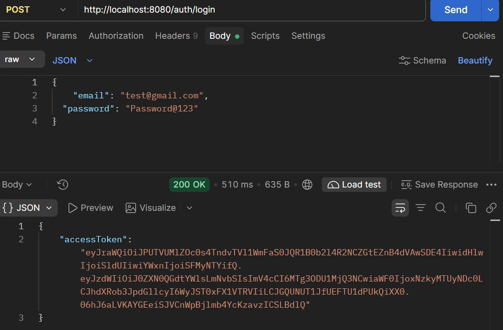
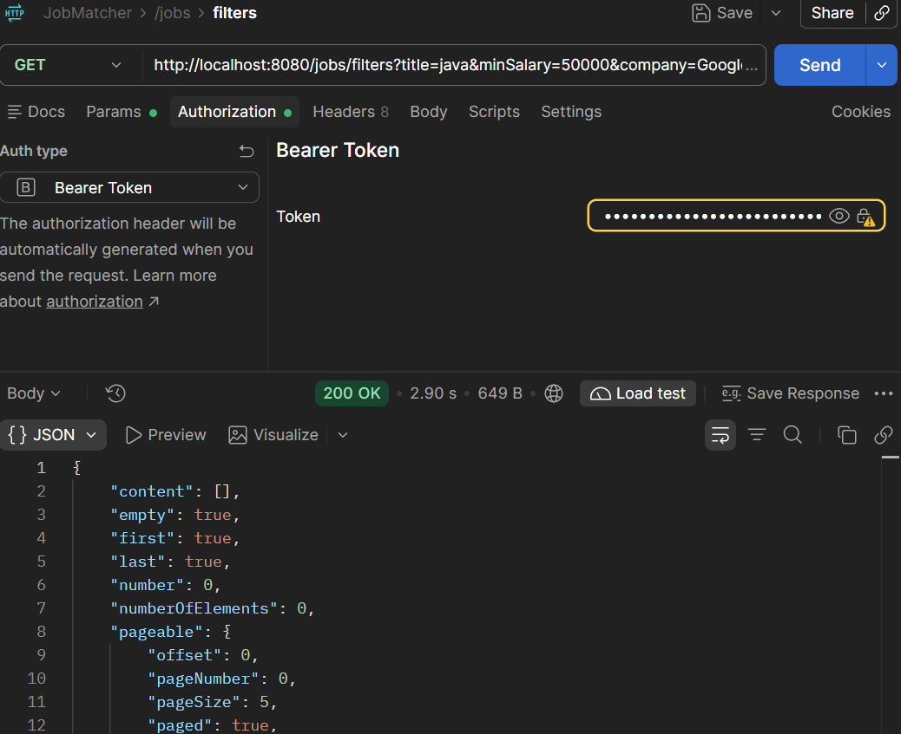
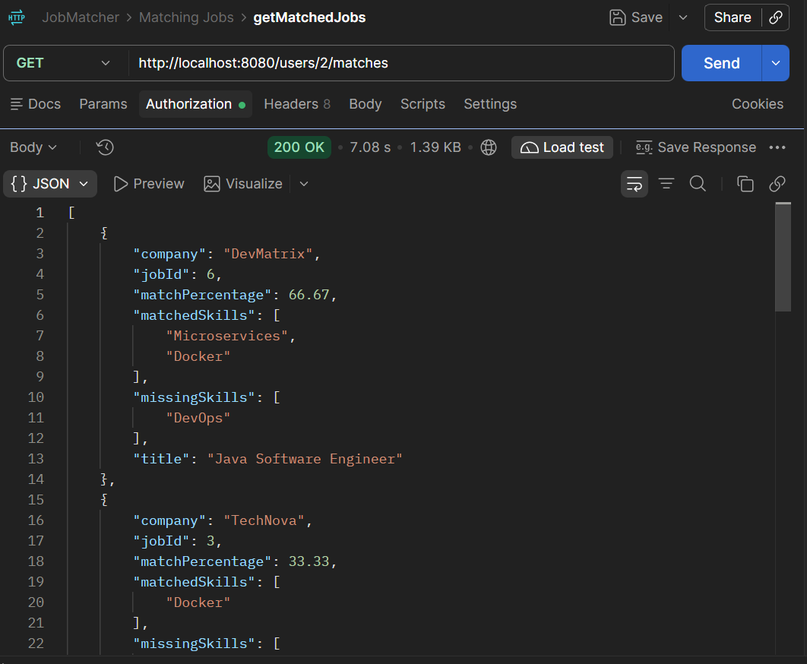

# Job Matcher

A backend job-matching platform built with **Java and Spring Boot** that connects users with relevant job opportunities based on their skills, experience level, and preferences.

The application provides REST APIs for authentication, user and job management, skill associations, dynamic filtering, and skill-based job matching. **PostgreSQL** is used for persistent storage, while **Redis** is used as a caching layer for frequently requested matching results.

---

## Overview

Job Matcher allows users to:

- Register and authenticate using JWT
- Manage their skills
- Browse and manage job opportunities
- Associate skills with users and jobs
- Filter jobs using multiple dynamic criteria
- Receive skill-based job matches
- View matched and missing skills for each job
- Retrieve matching results efficiently using Redis caching

The project follows a layered backend architecture using **Controllers, Services, Repositories, DTOs, Specifications, and Exception Handling**.

---

## Tech Stack

- **Java 21**
- **Spring Boot**
- Spring MVC
- Spring Data JPA
- Hibernate
- PostgreSQL
- Redis
- Maven
- Spring Security
- JWT
- Lombok
- ModelMapper
- Jakarta Bean Validation
- Git / GitHub
- Postman

---

## Core Features

### 1. User Management

- User registration and login
- JWT-based authentication
- User profile management
- User skill management
- Request validation using Jakarta Bean Validation
- Duplicate-resource and resource-not-found handling

### 2. Job Management

- Create, read, update, and delete jobs
- Job-to-skill association
- Retrieve jobs with their associated skills
- Experience-level classification
- DTO-based request and response handling

### 3. Skill-Based Job Matching

The matching system compares a user's skills against the skills required by available jobs.

For each job, the API provides:

- Match percentage
- Matched skills
- Missing skills
- Job details

Jobs are ranked in descending order of match percentage.

Example:

```json
{
  "jobId": 12,
  "title": "Java Backend Developer",
  "company": "Example Tech",
  "matchPercentage": 75.0,
  "matchedSkills": [
    "Java",
    "Spring Boot",
    "SQL"
  ],
  "missingSkills": [
    "Redis"
  ]
}
```

### 4. Dynamic Job Filtering

Jobs can be filtered using multiple optional parameters:

- Job title
- Company
- Minimum salary
- Experience level
- Required skill

The combined filtering functionality uses **Spring Data JPA Specifications**, allowing multiple filters to be dynamically combined without creating a separate repository method for every possible combination.

### 5. Pagination & Sorting

Job listing and filtering APIs support:

- `pageNum`
- `pageSize`
- `sortBy`
- `sortDir`

This allows large job datasets to be retrieved incrementally instead of loading all records into memory.

### 6. Redis Caching

Redis is used to cache frequently requested job-matching results.

The matching endpoint follows a **cache-aside strategy**:

1. Check Redis for the user's cached matching results.
2. If the data exists, return the cached result.
3. If there is a cache miss, calculate the matches from PostgreSQL.
4. Store the calculated result in Redis.
5. Return the response.

User-specific cache keys follow the pattern:

```text
users:{userId}:matches
```

Cached matching results use a **10-minute TTL**.

Relevant user-skill changes invalidate the corresponding cache entry to prevent stale matching results.

---

## API Structure

### Authentication

```text
POST /auth/register
POST /auth/login
```

### Jobs

```text
GET    /jobs
POST   /jobs
GET    /jobs/{id}
PUT    /jobs/{id}
DELETE /jobs/{id}
```

### Job Filtering

```text
GET /jobs/filters
```

Supported query parameters:

```text
title
experienceLevel
minSalary
company
skillName
pageNum
pageSize
sortBy
sortDir
```

Example:

```text
GET /jobs/filters?title=developer&experienceLevel=FRESHER&minSalary=500000&skillName=java&pageNum=0&pageSize=5&sortBy=salary&sortDir=desc
```

### User Skills

```text
POST   /users/{userId}/skills/{skillId}
GET    /users/{userId}/skills
DELETE /users/{userId}/skills/{skillId}
```

### Job Skills

```text
POST   /jobs/{jobId}/skills/{skillId}
GET    /jobs/{jobId}/skills
DELETE /jobs/{jobId}/skills/{skillId}
```

### Job Matching

```text
GET /users/{userId}/matches
```

Returns jobs ranked by match percentage along with matched and missing skills.

---

## API Testing

The REST APIs were tested using **Postman** for authentication, CRUD operations, skill management, filtering, and job matching.

### Authentication

![User Registration]
(docs/screenshots/register.png)



### Job Filtering



### Skill-Based Matching



> Screenshots demonstrate the API requests, responses, HTTP status codes, and key backend functionality.

---

## Database Design

The application uses PostgreSQL for persistent data storage.

### Core Entities

```text
User
Skill
Job
UserSkill
JobSkill
```

`UserSkill` and `JobSkill` are association entities used to represent the many-to-many relationships between users, skills, and jobs.

### Relationship Overview

```text
User
 └── UserSkill ── Skill

Job
 └── JobSkill ── Skill
```

---

## Architecture

The application follows a layered backend architecture:

```text
Client
   ↓
Controller
   ↓
Service
   ↓
Repository
   ↓
PostgreSQL
```

Redis is integrated at the service layer as a caching layer for frequently requested matching results.

### Project Structure

```text
src/main/java/com/jobMatcher/project

├── controller
├── service
├── repository
├── entity
├── dto
├── enums
├── specification
├── exception
└── configuration
```

---

## Validation & Exception Handling

The application includes centralized validation and exception handling.

Implemented handling includes:

- Request validation
- Resource-not-found exceptions
- Duplicate-resource exceptions
- Invalid request handling
- Global exception handling
- Consistent API error responses

---

## Running the Project

### Prerequisites

Make sure the following are installed:

- Java 21
- Maven
- PostgreSQL
- Redis

### Clone the Repository

```bash
git clone https://github.com/Tushaar01-hub/JobMatcher.git
cd JobMatcher
```

### Configure the Application

Configure PostgreSQL and Redis in:

```text
src/main/resources/application.properties
```

Example:

```properties
spring.datasource.url=jdbc:postgresql://localhost:5432/jobmatcher
spring.datasource.username=YOUR_USERNAME
spring.datasource.password=YOUR_PASSWORD

spring.data.redis.host=localhost
spring.data.redis.port=6379
```

### Run the Application

Linux / macOS:

```bash
./mvnw spring-boot:run
```

Windows:

```bash
mvnw.cmd spring-boot:run
```

The application runs by default at:

```text
http://localhost:8080
```

---

## Project Highlights

- RESTful backend APIs using Spring Boot
- JWT-based authentication
- DTO-based API design
- Skill-based job matching and ranking
- Dynamic multi-parameter filtering using JPA Specifications
- Pagination and dynamic sorting
- PostgreSQL database integration
- Redis cache-aside implementation
- Cache invalidation and TTL-based caching
- Bean validation
- Global exception handling
- Layered architecture
- API testing with Postman

---

## Future Improvements

- OAuth2 / social authentication
- React-based frontend
- Database indexing and query optimization
- Keyset pagination for large datasets
- More advanced job recommendation algorithms
- Asynchronous/background processing for expensive operations
- Rate limiting and circuit breaker patterns
- Swagger / OpenAPI documentation
- Comprehensive unit and integration test coverage
- Docker and cloud deployment
- Monitoring and audit logging
- Exploring semantic/vector-based job and skill matching

---

## Author

**Tushaar**

B.Tech Computer Science

[GitHub](https://github.com/Tushaar01-hub)
